# 环境准备

课前准备好工具、云服务、GitHub 和 AI 服务，课堂上直接开始作品。

打开[操作网页](preparation.html)，按当前一步做。

本阶段预计 70–180 分钟。含工具安装及账号准备；平台特殊审核可能延长（教学估算）

时间为教学估算。首次安装、健康复用与旧环境迁移分别计算，网络/平台/重启/本人操作可能延长；助手说明实际等待和超时。优化目标尚待实测，不以等待或旧结果冒充完成。

## 第 1 步：安装并打开 Trae

**在哪操作**：浏览器 → Trae

**这样做**：

本步骤预计 10–20 分钟（教学估算）

需要授权或本人试用时，助手会给出具体动作；超过预计时间会说明原因及下一步。

1. 下载 Trae 安装软件包。链接：https://www.trae.cn/（推荐在Huawei-Guest 网络操作）
2. 安装 Trae 软件。优先选择“自定义安装”，将 Trae 安装在非系统盘（默认课程根目录 D:\AI-Practice）（如下第2个图）。
3. 点右上角的“Agent”，进入工作台模式（有可能每次启动都需要点一下）。
4. 登录 Trae（推荐在 Huawei-Guest 网络登录）。
5. 选择“亮色”皮肤，告别黑暗色。
6. 电脑Wi-Fi切回到 wlanaccessv2.0 网络，设置xGate代理在国内，设置 Trae 的网络代理为国内。退出并重新打开Trae软件。
7. 认识 3 个与 Trae 交互的选项：①中输入文字/图片，和 AI 对话；②选择合适的模型，需考虑是否有图片理解能力；③选择本地的工作文件夹。
8. 建议在 D 盘根目录下创建本课程的 AI-Practice 目录，在 Trae 选择本地工作文件夹 AI-Practice。

**操作截图（点击图片查看原图）**：

[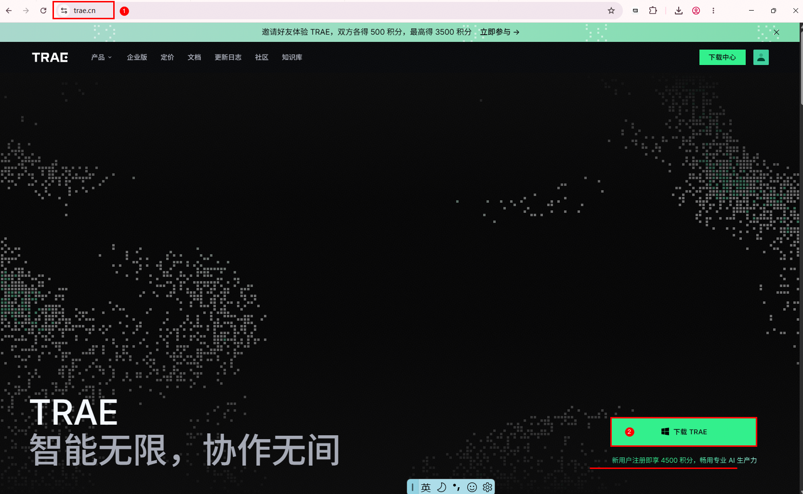](images/e02-1-download-installer.PNG)

[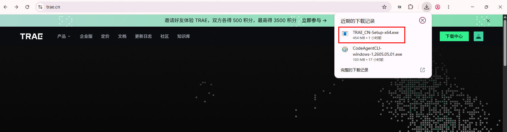](images/e02-2-1-run-installer.PNG)

[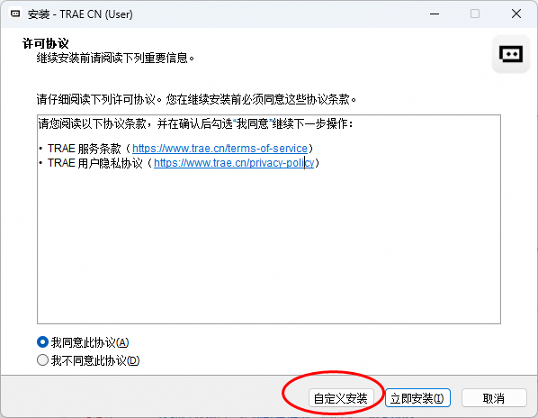](images/e02-2-custom-dir.PNG)

[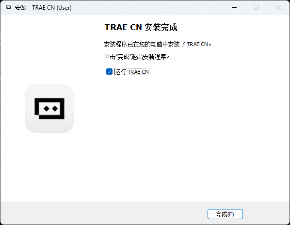](images/e02-2-2-installing.PNG)

[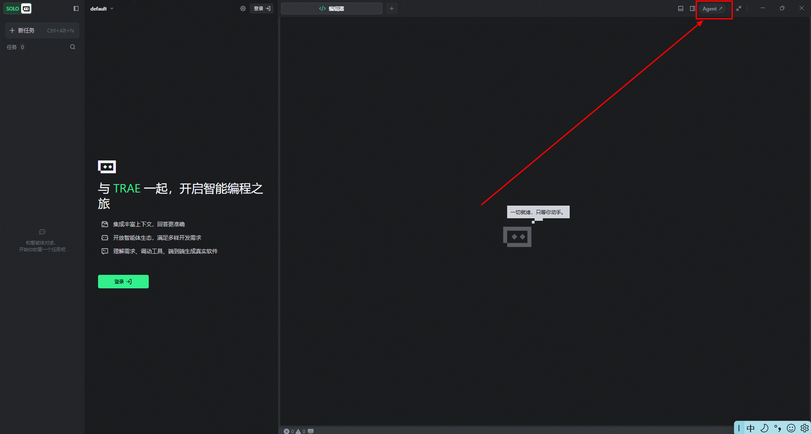](images/e02-3-agent-workbench.PNG)

[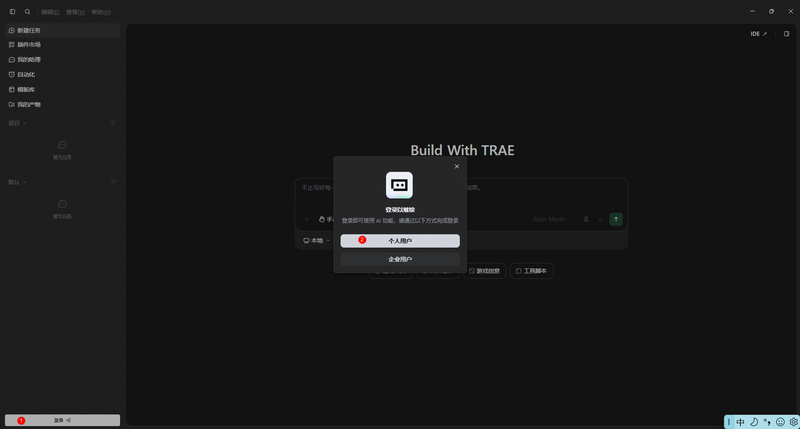](images/e02-4-login.PNG)

[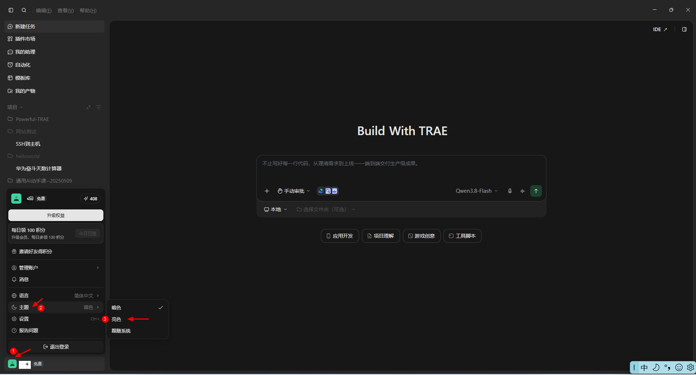](images/e02-5-light-theme.PNG)

[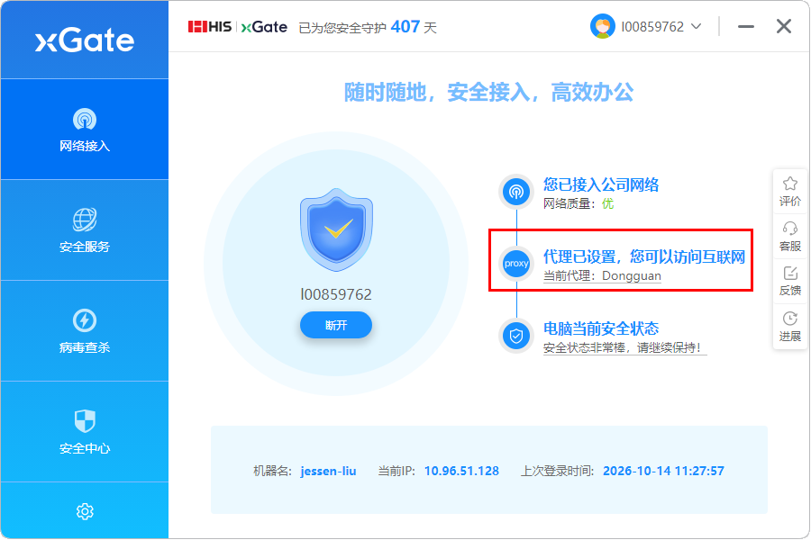](images/e02-6-2-xgate-proxy-china.PNG)

[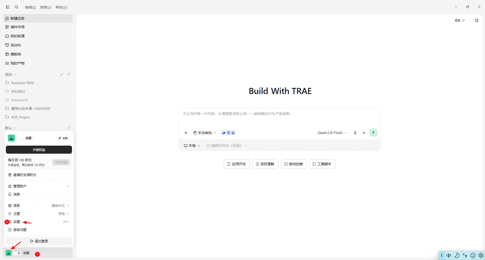](images/e02-6-1-settings.PNG)

[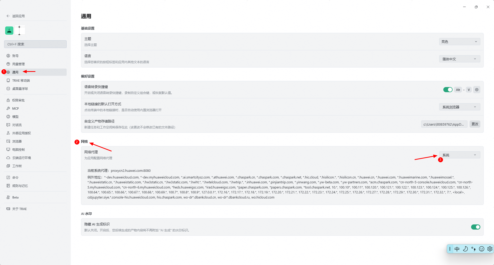](images/e02-6-3-proxy-system.PNG)

[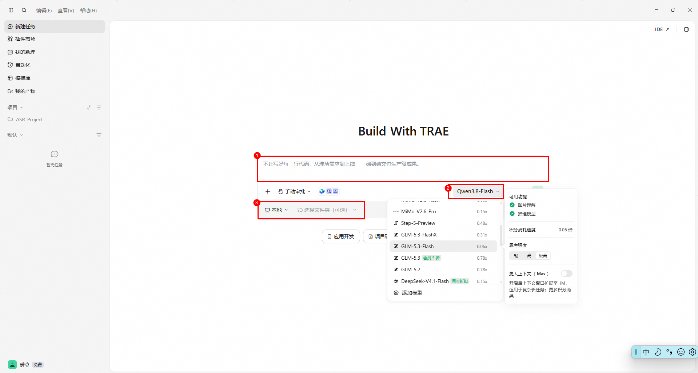](images/e02-7-three-options.PNG)

[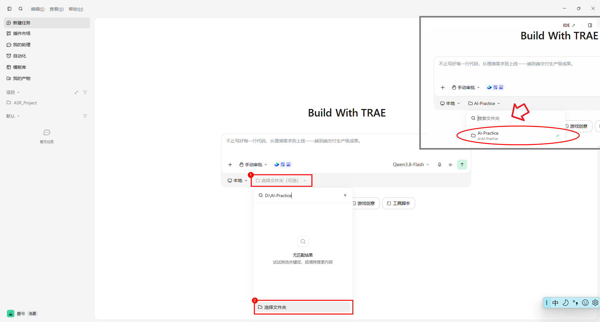](images/e02-8-workspace-folder.PNG)


**常见问题和操作**：

**潘少《通用AI动手》课要花钱，这次的Trae是否要充值？**

新用户首次注册赠送了4500积分，不够之后再充值。

**遇到模型不响应/输出怎么办？**

大概率是网络环境的问题，尝试重启Trae，检查接入的网络和代理。

**运行审批是否有风险？**

Trae在项目的文件空间里工作时，基本上直接点“运行”允许即可。有些任务有多次运行，容易忽略导致等待时间过长，需要多关注Trae的运行授权请求（有声音提醒）。

**为什么Trae让我接管浏览器？**

Trae内置了浏览器会进行一些自动化网页操作，但是需要登录/密码等场景时，需要人工接管操作，输完密码后在对话框告诉Trae已完成，让它继续操作。

**选择什么模型好？**

默认建议采用GLM-5.2（较快），需要识别图片的时候建议采用GLM-5.3-FlashX。

**有条件的申请一个“安全上网服务”，时间可以是1个月**

操作参考下方动画。

[](images/e02-faq-safe-internet.gif)


[下载 Trae](https://www.trae.cn/)


**完成后**：

- Trae 已打开并登录。

**你来确认**：

- Trae 已打开，能找到“打开文件夹”。

<details><summary>遇到问题再看</summary>

出现“是否信任此文件夹中的文件作者”时，先核对提示中的完整路径是否是自己选的课程资料或作品；由本人判断并处理。看到其他目录就先切回正确目录，不要为继续操作信任所有上级目录。公司电脑不允许安装时请联系 IT 支持人员。

</details>

步骤编号：E-02

## 第 2 步：让 Trae 完成课前准备

**在哪操作**：Trae

**这样做**：

本步骤预计 45–120 分钟；复用约 3–10 分钟（教学估算）

下载期间保持网络连接，留意 Trae 的授权提示；如需重启，保存工作后重启并回到原目录继续。 助手记录真实开始、等待和接续；遇到异常先定位原流程，不反复重装/重部署。

由 Trae 准备 Podman CLI 与独立 Docker Compose，已有作品沿原记录恢复，无需操作 Desktop。

1. 在 Trae 点“打开文件夹”，选择一个用于课程练习的文件夹；没有就新建一个。出现信任提示时，由本人核对并决定。
2. 在聊天框发送下方提示；需要选择模式时，选 Agent（智能体）。
3. 按助手提示处理必要授权、条款、费用或重启；完成后它会继续。重启后回原任务说“请继续未完成的课前准备”。

**现在复制到 Trae**：

```text
请使用 Podman CLI 和独立 Docker Compose，无需 Desktop。已有工程沿用原工具记录。请按这份课程准备说明连续完成全部课前准备：https://siatwangmin.github.io/aicoding-course/setup-guide.md。工具、腾讯云、GitHub和AI服务按顺序准备，最后汇总结果；已有内容直接用。较大的软件、镜像和数据默认放D盘，保存成果让新文件夹的作品直接复用。需要我操作时，一次告诉我一个动作。现在先不创建作品。
```


**完成后**：

- 助手连续准备工具、云服务、GitHub和AI，并说明各项结果；未完成时给当前一个动作。

<details><summary>遇到问题再看</summary>

新环境由 Trae 准备 Podman 和独立 Compose，已有工程沿用原记录；下载、安装、配置和检查由助手完成。后面几页对应同一次准备的各阶段，已完成不用重复发送提示；只有中断或缺项才用该页提示恢复。本人只处理身份、条款、费用或重启。 A目录保存准备报告；大型环境数据默认D:\AI-Practice，项目B可以在另一目录，后续由助手发现复用。已有环境先核原绑定，只补缺项；首次安装、健康复用、旧环境迁移分别估时。

</details>

步骤编号：E-01

## 第 3 步：课前接好云服务

**在哪操作**：Trae 与它打开的授权页面

**这样做**：

本步骤预计 10–25 分钟（教学估算）

需要授权或本人试用时，助手会给出具体动作；超过预计时间会说明原因及下一步。

1. 助手已经完成这一项时，直接看结果并进入下一页；仅中断或未完成时发送下方恢复提示。
2. 跟随助手打开的页面，本人完成登录或注册、实名和授权；已有账号直接用。
3. 查看助手说明的免费资格或费用，由本人决定；等它确认准备结果。

**仅未完成时，复制到 Trae**：

```text
请用课程的云服务陪练带我准备腾讯云 CloudBase。已有账号和准备结果直接用；需要我登录、实名、授权或决定费用时，一次告诉我一个动作。配置和连接检查由你完成，最后告诉我是否准备好。
```


**完成后**：

- 助手确认云服务已准备好；未通过时说明当前缺项。

<details><summary>遇到问题再看</summary>

密码、验证码和实名信息只在本人页面填写。此时不用创建作品或发布网页。 本页是同一次课前准备的接续入口，已完成不用重复操作。

</details>

步骤编号：E-06

## 第 4 步：课前准备 GitHub 账号

**在哪操作**：Trae 与它打开的 GitHub 页面

**这样做**：

本步骤预计 5–15 分钟（教学估算）

需要授权或本人试用时，助手会给出具体动作；超过预计时间会说明原因及下一步。

1. 助手已经完成这一项时，直接看结果并进入下一页；仅中断或未完成时发送下方恢复提示。
2. 按助手打开的页面完成本人登录或注册、邮箱验证。
3. 等助手确认账号准备好，再继续下一步。

**仅未完成时，复制到 Trae**：

```text
请用课程的 GitHub 陪练带我准备免费账号。已有账号直接用；需要我操作时，一次告诉我一个动作。登录和邮箱状态由你检查，最后告诉我是否准备好。
```


**完成后**：

- 助手确认 GitHub 账号可以使用。

<details><summary>遇到问题再看</summary>

密码、验证码和条款由本人在官网处理，不发到聊天里。此时不用创建仓库或设置推送工具。 本页是同一次课前准备的接续入口，已完成不用重复操作。

</details>

步骤编号：E-07

## 第 5 步：准备自己的 AI 服务账号

**在哪操作**：Trae 与它打开的硅基流动页面

**这样做**：

本步骤预计 5–15 分钟（教学估算）

需要授权或本人试用时，助手会给出具体动作；超过预计时间会说明原因及下一步。

1. 复制下面提示到 Trae，由助手引导打开硅基流动官方入口。
2. 本人注册或登录，查看当前可领取优惠及费用，决定是否充值。
3. 保存准备结果，API Key 和模型将在程序具备设置入口后由本人配置。

**仅未完成时，复制到 Trae**：

```text
请调用ai-coding-siliconflow，带我注册或登录自己的账号，查看当前优惠和费用，由我决定是否充值。记录账号准备结果，程序里的 Key 和模型配置留到 AI 开发阶段完成。
```


**完成后**：

- 本人已登录并了解当前费用，充值决定已记录。
- 账号准备与后续 Key、模型调用及作品功能验收分别记录。

**你来确认**：

- 我已了解当前优惠和费用，知道后续要在程序中配置自己的 Key 和模型。

<details><summary>遇到问题再看</summary>

Key不发聊天。本人注册登录，查看优惠及费用，决定是否领券、充值（均可跳过）；助手只记录账号准备。首次V4在程序设置填写模型Key，配置和调用另验，旧凭证仅明确旧工程兼容。已完成的账号操作不用重复。

</details>

步骤编号：E-08

## 第 6 步：最后确认课前准备结果

**在哪操作**：Trae → 检查报告

**这样做**：

本步骤预计 3–10 分钟（教学估算）

需要授权或本人试用时，助手会给出具体动作；超过预计时间会说明原因及下一步。

1. 助手已给出全部准备的汇总时查看结论；尚未汇总或有缺项时发送下方提示继续。
2. 若助手说“还没完成”，只处理它指出的当前缺项。
3. 助手确认课前准备完成后，点“进入 AI Coding 操作手册”。

**仅未完成时，复制到 Trae**：

```text
请汇总前面工具、云服务、GitHub 和 AI 服务的准备结果，必要时实际复查。缺项请继续处理；需要我操作时一次告诉我一个动作。最后用一句话说明课前是否已准备好，未通过的不要写成完成。现在先不创建作品。
```


**完成后**：

- 助手确认四项课前准备完成，可以开始课堂操作。

<details><summary>遇到问题再看</summary>

你不用阅读日志或逐项检查配置；看助手的明确结论即可。此时还没有作品业务页面是正常的。

</details>

步骤编号：E-05
